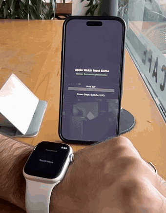

# Watch Input for Unity

Use **Apple Watch** as an input device for Unity iOS games — taps, swipes, press-and-hold
and the Digital Crown on the watch, haptic feedback back to the wrist.
Install the package and your iOS build **automatically gains a watchOS app**. No Xcode editing,
no scene setup.

<p align="center"></p>

```csharp
using WatchInput;

void Update()
{
    if (Watch.Tapped)                       Jump();
    if (Watch.TryGetSwipe(out var dir))     Dash(dir);
    if (Watch.IsPressed)                    ChargeShot();
    menu.Move(Watch.CrownSteps);            // whole Digital Crown detents this frame
}

void OnHit() => Watch.PlayHaptic(WatchHaptic.Success);
```

---

## The build step is the hard part

Unity regenerates the Xcode project from scratch on every iOS build, so a watchOS app can't simply
live in it. This package adds one from code, every build, in a single `PostProcessBuild` step:

- adds a single-target SwiftUI **watchOS app target** (`SDKROOT=watchos`, device family 4,
  `WKApplication`, companion bundle ID, `SKIP_INSTALL`, versions mirrored from Player Settings)
- copies the Swift sources from the package and adds them with **relative** paths
- adds the **Embed Watch Content** phase before Unity's postprocess phase
  (`AddCopyFilesBuildPhaseBeforeTargetPostprocess`, which also returns the existing phase on re-runs)
- links `WatchConnectivity.framework` to `UnityFramework`
- generates the watch **app icon** asset catalog and a Swift config file from your settings
- **inherits signing** from Player Settings (automatic or manual) — it never changes the signing of your iOS app
- is **idempotent**: Unity's *Append* builds don't add anything twice

Everything is configured from **Project Settings › Watch Input**, and a pre-build check turns
missing setup into one readable line in the Unity console instead of an Xcode error.

## Install

Requirements: Unity 6 (6000.0+) with iOS Build Support, Xcode, an iPhone paired with an Apple Watch.
Tested with Unity 6000.2.8f1. Unity 6 is required because the build step embeds the watch app with
`PBXProject.AddCopyFilesBuildPhaseBeforeTargetPostprocess`, which is documented from Unity 6.0; earlier versions
are untested.

**Package Manager › + › Add package from git URL**

```
https://github.com/Sadi-Unity/unity-apple-watch-input.git
```

Then:

1. **Player Settings › iOS**: set *Signing Team ID* (and *Automatically Sign* if you use it).
2. **Project Settings › Watch Input**: watch app name, icon (1024×1024 PNG, no alpha), Digital Crown options.
3. Build for iOS. Run from Xcode. If the watch app doesn't appear on the watch, install it from the
   iPhone **Watch** app (see Troubleshooting).

**Try the sample first:** in Package Manager select *Watch Input for Unity*, open the **Samples** tab
(next to *Description*), click **Import** next to *Basic Demo*, then open
`Assets/Samples/Watch Input for Unity/<version>/Basic Demo/BasicDemo.unity` — a scene that shows every input on
screen and plays haptics back. In the Editor, click / hold / use the arrow keys / scroll to simulate the watch.
The haptic played for each input is chosen in the Inspector on the *Watch Input Demo* object — or call
`Watch.PlayHaptic(...)` from your own code; the package carries input, the feel is up to your game.

## API

All members are static on `WatchInput.Watch`. Per-frame values are valid for the frame they were produced in,
like Unity's `Input` class. Nothing has to be added to a scene.

| Member | |
|---|---|
| `Tapped`, `TapCount` | tap(s) this frame |
| `TryGetSwipe(out WatchSwipe dir)` | next swipe this frame (`Up`, `Down`, `Left`, `Right`) |
| `PressStarted`, `IsPressed`, `PressEnded` | press-and-hold (≥ 0.3 s) |
| `CrownDelta` | Digital Crown rotation this frame, in detents (float) |
| `CrownSteps` | whole detents this frame; the fraction carries over to the next frame |
| `PlayHaptic(WatchHaptic)` | haptic on the watch (9 types, rate-limited to 80 ms) |
| `IsReachable`, `Status` | connection state |
| `DebugLogging` | native logs, including packet-age (latency) statistics |
| events `Tap`, `Swiped`, `PressBegan`, `PressReleased`, `CrownRotated` | same data as callbacks |

**In the Editor** (and on non-iOS platforms) the same API is driven by mouse/touch and keyboard:
click = tap, hold = press, arrow keys / WASD = swipe, scroll wheel = crown. Works with the Input System
package and the legacy Input Manager; the active source is logged once at startup.

## Design decisions

- **Recognition happens on the watch.** A single `DragGesture` state machine turns touches into
  tap / press / swipe; the phone receives meaningful events, not raw touches.
- **Small binary protocol** over `WCSession.sendMessageData` (3–14 bytes per message, version byte first)
  instead of dictionary messages.
- **Every input carries its send time.** iOS can wake the app in the background for a watch message and
  delivers messages sent while the app was closed when it next launches. Packets older than 1 s, and packets
  that arrive while the app is not active, are dropped — the game never receives a burst of stale taps.
- **Press is a state channel, not just two events.** While held, the watch repeats a keep-alive every 250 ms;
  if the phone hears nothing for 600 ms it releases the press itself, and the app going to the background
  releases it too. `PressReleased` fires in every case, so a lost "release" can't leave a button stuck.
- **Pull model across the native boundary.** The Objective-C++ bridge buffers events in a fixed ring buffer;
  C# drains it once per frame into a preallocated blittable struct array through a C ABI.
  No `UnitySendMessage`, no callbacks from foreign threads, **no per-frame GC allocations**.
- **PlayerLoop instead of a GameObject.** The input pump is injected into `PreUpdate`, survives scene loads and
  works with domain reload disabled. Frame state is completed before any event fires, and every subscriber is
  isolated: one throwing handler doesn't stop the others.
- **`[assembly: AlwaysLinkAssembly]`.** The package's only entry point is a `RuntimeInitializeOnLoadMethod`;
  without this attribute IL2CPP silently stripped the whole assembly from player builds.
- **Phone state is published with `updateApplicationContext`** (latest-value semantics, delivered even when the
  watch app isn't running), so the watch can tell "open the game on your iPhone" apart from "raise your wrist".

More detail: [Documentation~/DEVELOPMENT.md](Documentation~/DEVELOPMENT.md).

## Limitations (measured, not assumed)

Measured on iPhone 16 Pro Max + Apple Watch Series 8, watchOS 26.6, default display settings.
Other models and settings will differ.

- **Foreground only.** Input flows while the watch app is open and the screen is awake.
  There is no background session (no HealthKit workout, no `WKExtendedRuntimeSession`).
  - Untouched, the screen stayed awake ~70 s.
  - With a touch every 5–15 s it never slept (tested > 2 min).
  - Lowering the wrist dims the screen and pauses the connection; raising it reconnects immediately.
- **Latency** (watch send → phone receive, from packet timestamps): typically 55–110 ms average with peaks
  around 175 ms once the session is warm; up to ~490 ms in the first second after connecting. Watch and phone
  clocks are synchronised by the system, so these numbers include any small clock offset.
- **Press keep-alive** intervals were observed between ~205 and ~450 ms (target 250 ms); the 600 ms release
  timeout leaves ~150 ms of margin.
- **Signing.** Only automatic signing has been tested on a device; manual signing is implemented and unit-tested.
  - If CI passes signing settings on the `xcodebuild` command line (e.g. `PROVISIONING_PROFILE_SPECIFIER=…`),
    they apply to **every** target, including the watch app; give the watch target its own profile and add its
    bundle ID (`<app id>.watchkitapp`) to your export options.
  - With an empty Team ID the watch target gets no `DEVELOPMENT_TEAM` (a pre-build warning tells you).
  - The companion bundle ID is written at build time; if your pipeline changes the iOS bundle ID after the
    Unity build, change the watch target's too.
- Swipes that start at the very edge of the watch screen may be taken by the system.

## Troubleshooting

- **Watch app not installed / not updated after a build** — open the iPhone **Watch** app and install it from
  *Available Apps*. If it doesn't update, delete it from the watch and install again.
- **"Open the game on your iPhone" on the watch** — the iPhone app is not in the foreground.
- **Signing errors in Xcode** — check the `[WatchInput] Preflight:` lines in the Unity console; set Signing Team ID
  in Player Settings rather than in Xcode (Xcode edits are lost on the next build).
- **Nothing arrives in Unity** — set `Watch.DebugLogging = true` and watch the Xcode console for `[WatchInput]` lines.

## Tests

41 EditMode tests (all passing on Unity 6000.2.8f1, with iOS as the active build target) cover the build step against an Xcode project generated by
Unity from an empty project (target creation, idempotency counted after a second run, build settings, signing
branches, icon catalog, generated Swift config), the settings validators and the runtime input pump (crown
remainder, event ordering, subscriber isolation, handling of the release event sent when the app is backgrounded, and **no GC
allocation per frame**, asserted with `Is.Not.AllocatingGCMemory()`).
To run them in your project add `"testables": ["com.sadiakdemir.watch-input"]` to `Packages/manifest.json`.

## How this was built

I designed the architecture, the watch ↔ phone protocol and the public API, wrote the specification for each
step, and AI coding agents implemented against those specs. I reviewed every diff from disk (with an AI
review assistant), built and tested on device, and took the measurements above. Review, tests and the device
caught defects such as an invented API, the IL2CPP assembly being stripped silently, and my own first fix for
stale input, which the device disproved. An independent review before 0.1.1 found that the embed-phase step
re-implemented an API Unity already ships; it now uses that API.

Not yet verified: manual signing on a device, and Unity versions other than 6000.2.8f1.
The process and the full defect log: [Documentation~/DEVELOPMENT.md](Documentation~/DEVELOPMENT.md).

## License

[MIT](LICENSE)
